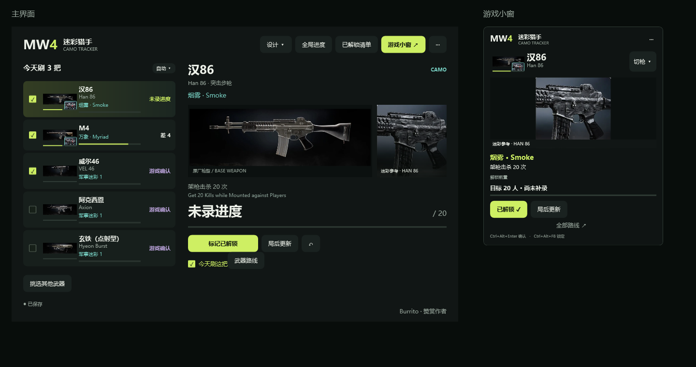

# MW4 迷彩行动台

Windows 独立迷彩计划工具。选好今天刷的武器，游戏中用小窗看目标，局后统一更新进度。

[下载 v0.4.0 试用版](https://github.com/AlanHelium/mw4-camo-tracker/releases/tag/v0.4.0) · [提交问题](https://github.com/AlanHelium/mw4-camo-tracker/issues)

## 开始使用

1. 下载 Windows x64 压缩包，解压后运行 `CamoTracker.exe`。免安装，无需另装 .NET。
2. 在「已有解锁」勾选已经拥有的迷彩；在「武器等级」记录当前等级与武器巅峰阶段。
3. 勾选今天刷的武器，最多 5 把。未制定计划时，默认推荐 5 把。
4. 打开游戏小窗。局后选择「已解锁」，或输入游戏内当前总进度。

运行包中的 `打开游戏小窗.cmd` 可直达小窗。建议搭配无边框窗口；独占全屏置顶和游戏内热键接收仍需实机验证。

## 功能

- 主界面与小窗共用深色、酸橙绿视觉；特殊、完成主义、巅峰路线有辅助色。
- 今日计划同步到小窗；优先推荐已知前置满足、接近完成的目标，也可指定「本局冲这个」。
- 历史解锁清单、前置条件、武器巅峰门槛；未知进度不会当成 0。
- 18 种官方静态外观参考，可查看原图；缺少确切图片的项目显示类别标识。
- 置顶、拖动、透明度、大小、鼠标穿透；自动保存、撤销、JSON 导入导出。
- 作者提供的原始赞赏码，全部功能免费。

配图包含官方示例枪身，不是 PBR 材质、实时 3D 枪模或动态迷彩，尚未覆盖全部迷彩图片。

## 操作

不要求逐个记录击杀。局后填总进度或勾选已解锁。单局、连杀等挑战以游戏内确认的完成次数为准，击杀数不等于挑战完成次数。

| 快捷键 | 操作 |
| --- | --- |
| Ctrl + Alt + Enter | 标记当前迷彩已解锁 |
| Ctrl + Alt + 1～5 | 选中小窗对应行 |
| Ctrl + Alt + Z | 撤销 |
| Ctrl + Alt + M | 切换主界面与小窗 |
| Ctrl + Alt + Space | 隐藏 / 显示 |
| Ctrl + Alt + L | 锁定小窗、鼠标穿透 |

L 被占用时尝试 Ctrl + Alt + F8，以界面显示为准。解锁热键不可用时禁止启用穿透。对话框打开时暂停处理热键。

存档：`%LOCALAPPDATA%\CamoTracker\progress.json`。保存时保留 `.bak`，旧版数据升级前另留迁移备份。

## 数据范围

2026-10-23 整理：33 把武器，每把 8 项军事、3 项特殊、3 项完成主义条件，另列武器巅峰和模式精通路线。条件主要来自公开社区资料，**不是逐项实机核验的官方完整数据库**。缺失、冲突和开放等级未知的项目会显示待核对，详情保留来源与可用的 DMZ 条件参考。

武器巅峰（俗称武器转生）与玩家巅峰不同。Pyroclast 对应武器巅峰 1 级；Terminus 对应该轮满级；Scatter / Cascade 对应武器巅峰大师 150 / 250 级。进入巅峰不会一次开放全部巅峰迷彩。

多人条件用于推荐；DMZ 文字供对照，不自动换算跨模式进度。账号与真实解锁状态需手动确认。详见 [数据来源与边界](docs/DATA.md)。

## 性能与游戏配合

不截取游戏画面、不读游戏内存、不注入、不使用驱动，不连接游戏账号。运行时无联网下载、游戏进程扫描或定时刷新；界面在操作时更新，图片静态缓存。仅注册系统全局快捷键。

[测试记录](docs/VALIDATION.md) 包含本机待机占用。尚无游戏帧率对照实测，不能承诺零性能影响或所有游戏环境兼容。

默认输入兼容模式支持数字、英文与中文粘贴；正常中文 IME 可用 `CamoTracker.exe --system-ime` 启动。当前电脑系统 TSF 曾导致 WPF 挂起，因此默认只在本进程禁用 TSF，不改系统设置。

## 构建

Windows 10/11 x64，开发需 .NET 10 SDK，运行 `powershell -File scripts/build.ps1`。无第三方运行时依赖。

`--self-test` 执行模型验证；`--screenshot <绝对路径.png>` 使用隔离的内存演示数据验证并渲染界面，不读写用户存档。README 截图是演示进度。

条件整理脚本 `scripts/import-community-catalog.py` 需要 Python 与 `beautifulsoup4`，只提取事实字段；结果应人工复核后提交，客户端不会自动抓取。

## 许可与支持

原创代码为 MIT；官方图片与商标属于各权利人，见 [NOTICE](NOTICE.md)。本工具与 Activision 无隶属或背书关系。在菜单中选择「赞赏作者」即可打开原始赞赏码。
