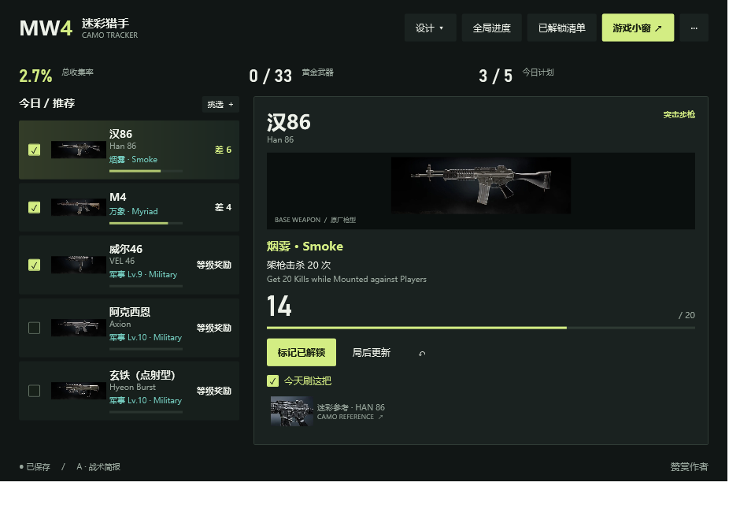
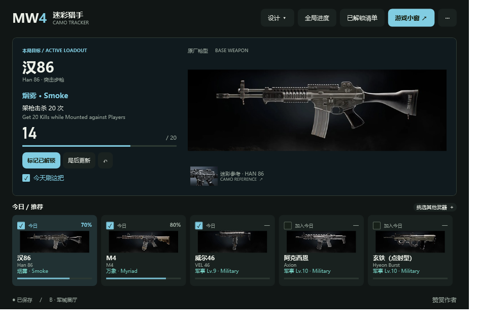
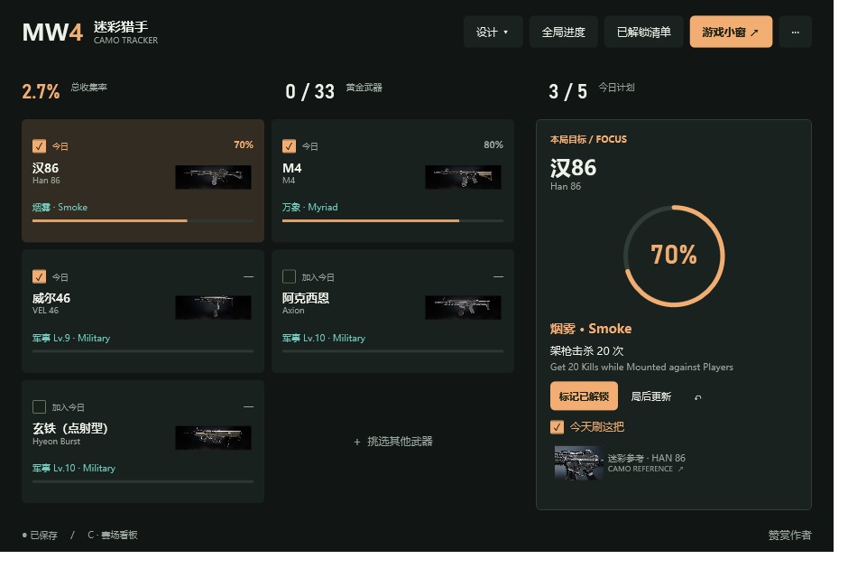

# 主界面设计对比 · v0.6.0

在主界面顶部「设计」切换。原版保留，三个新布局均使用现有武器、迷彩、计划和进度逻辑，不是只供观看的图片。

| 方案 | 布局 | 侧重 |
| --- | --- | --- |
| A · 战术简报 | 左侧今日/推荐列表，右侧任务卡，上方简短总览 | 查看本局目标和局后更新，紧凑直观 |
| B · 军械展厅 | 上方大枪型与任务信息，下方五张武器卡 | 枪型展示、快速切换，留白更清楚 |
| C · 赛场看板 | 左侧武器卡片矩阵，右侧环形进度与任务 | 比较多把武器进度 |

## A · 战术简报

## B · 军械展厅

## C · 赛场看板

截图使用隔离的演示存档，不是账号自动同步结果。三套布局保留官方中英文武器名、对应原厂枪型、迷彩参考、已解锁、局后更新、撤销、今日计划、全局进度、已有解锁清单与赞赏入口。

小窗同步所选强调色、选中状态和圆角；原厂枪型与 HAN 86 迷彩参考仍分开展示。布局全部用静态 WPF 元素绘制，没有背景视频、常驻动画或定时刷新。

设计选择自动保存，旧存档默认保持经典布局。全局进度、对话框和解锁提示继续共用现有功能。
