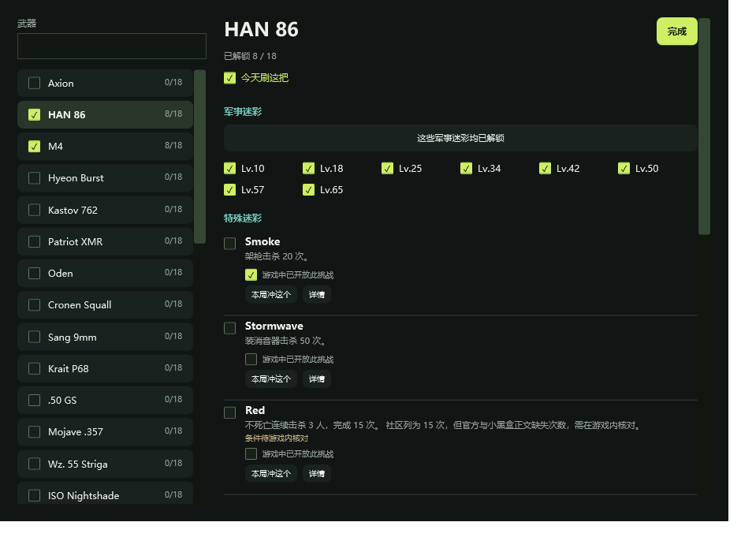

# v0.6.0 验证记录

2026-10-24，Windows 本机，Release / .NET 10 / win-x64 自包含单文件。

## 已通过

- 模型：33 把武器、99 项特殊迷彩；未知进度区别于零；历史解锁前置；同类别黄金与 33 白金门槛。
- 推荐：最近可做目标、用户指定目标、已完成目标接续；今日顺序、存档往返、取消、显式空计划、最多 5 把。
- 巅峰：未满级 / 满级、149 / 150 边界；冲突资料不能自动判完成，实际解锁可人工确认。
- 存档：旧版进度迁移、磁盘往返、备份与损坏恢复。
- 窗口：官方图片解码、主界面与 HUD 渲染、已解锁热键处理与撤销、鼠标穿透样式开关、选行与分页、返回主界面、原始赞赏码载入。
- 武器：33 张不同的官方枪型均能解码并冻结；33 把官方简中名称、英文名、满级对应；自定义武器不误用其他枪型。
- 双语：99 项特殊迷彩有中文参考译名，所有内置任务有英文条件；主界面与 HUD 实际文本树同时出现「威尔46」「VEL 46」，不以类别代替名字；用户改写条件后不残留旧英文。
- 解锁提示：设置能保存；提示窗不抢焦点、鼠标穿透、自动关闭，关闭时移除动画时钟；补录历史不触发连续动画。
- 原创音效：嵌入的 PCM WAV 头、长度验证；静态声音按需加载，播放一次即停止，菜单提供试听。
- 全局进度：594 项武器迷彩计数、按已解锁前置推导的计数不重复、路线完成/剩余百分比；未知、未核实项不伪装成百分比；最近目标按武器去重并排除锁定项；总览窗口实际渲染检查。
- 新主界面：3 套布局实际渲染；每套检查中英文武器文本、全局进度、已有解锁入口与确认按钮；实际触发武器卡点击，验证当前目标同步。旧存档默认经典布局，设计偏好 JSON 往返保留。
- HUD 选择：隐藏的小窗不能改写主界面的选中武器；打开小窗时对齐今日计划中的有效行；空计划禁用目标操作，确认快捷键不会改动无关挑战。

## 小窗待机占用

以下保留 v0.5.0 自包含发布版的 `--overlay` 观察，v0.6.0 的三套静态布局尚未另做性能或游戏 FPS 对照。通过系统进程计数器读取本工具自身，未启动或采样游戏。分别记录启动后和稳定运行后的 10 秒窗口；单次本机观察，非严格受控基准或跨机器保证。

| 观察窗口 | CPU 时间增量 | 平均 CPU，占单逻辑核 | 工作集 |
| --- | --- | --- | --- |
| 启动后 15 秒开始取样 10.001 秒 | 1.703125 秒 | 17.029% | 238.9 MiB |
| 后续稳定运行时取样 10 秒 | 0 秒（计数器精度内） | 约 0%，非绝对零消耗 | 257.6 MiB |

启动后窗口同时记录的私有内存为 138.1 MiB。启动与使用时存在明显短时 CPU 开销，不能用稳定待机的低数值代表所有操作场景。没有据此承诺零 FPS 影响。

工作集包含共享的 .NET/WPF 页面；不能将私有内存与工作集相加。没有游戏 FPS、帧时间、显存对照实测。无边框游戏叠加、独占全屏、游戏抢占热键、中文 IME 可选模式及不同 DPI 多显示器仍需真实环境反馈。

静置时没有持续动画、定时刷新、联网同步、录屏、截图识别、游戏进程探测、内存访问或注入。解锁时才短暂创建原生提示窗与动画，结束即关闭；Windows 关闭界面动画时使用静态短提示。静态外观图按需解码、冻结并缓存，枪型解码缓存最多 8 张，小窗使用操作触发的更新。

## v0.7.0 数据包更新验证

- 稳定 key 合并：武器改名、目标次数调整、新武器、新挑战；已解锁、局后总数、当前选择、焦点、今日计划均保留；自定义和手动编辑任务不被覆盖。
- 独立计数口径版本：改版任务的未完成旧计数变为未知，已解锁保留。
- 新武器中英文名和图片、新迷彩图加载；新的声明式前置和非 33 的全局门槛实际参与判断。
- 未来 schema 拒绝、ZIP 越界路径拒绝、完整图片和裁切验证；下载大小及 SHA256 验证。
- 模拟进度已写入、目录指针写入失败：恢复更新前存档；模拟中途退出：下次启动恢复事务备份。
- 资料更新窗口实际渲染、检查和离线导入按钮存在；无按钮动作时不请求网络。
- 所有资料测试使用临时目录，不修改玩家实际存档。未进行游戏帧率实测。

本版额外验证：日常完成和局后总数不能绕过前置；按节点恢复支持向前/向后校正和撤销，其他枪及独立分支保留；真实节点点击后白金按钮禁用，小窗武器行点击展开详情；截图包括作者 Burrito 的赞赏入口。预览热键被已运行正式实例占用会如实记入报告，不视为游戏热键实测。

公开网络验证发现 GitHub 未登录接口在共享出口有额度限制，因此增加同仓库静态 CDN 目录/图片下载，逐文件校验后组装；不将作者的 GitHub 令牌分发给客户端。

已实际验证公开网络下载：GitHub 接口限流时自动使用同仓库 CDN，目录与全部图片逐项 SHA256 通过，重新组装后完整目录/裁切/图片校验通过；资料版本 2026102401。首个独立包与本版内置目录相同，因此预览新增数为 0。

## v0.7.1 单枪小窗与军用奖励校正

- 小窗不再展开五枪列表和双路线，只显示当前枪型、中英文名、目标迷彩及简短操作；完整路线为独立入口，菜单保留常用项。打开小窗保留主界面所选武器，不强制跳到今日计划第一把。
- 实际触发「切枪」菜单项目，验证当前武器同步；前置未满足的白金完成按钮禁用，并显示同类别黄金已完成/需求数量及差额。
- 夜神军用奖励无需填写等级即可确认游戏实际已拥有；确认第一项只解锁该项并接续同枪下一目标，不误标全部 0 门槛项目；撤销恢复原状态。数值计数不能绕过待核实前置。
- 任意军用节点补历史只补到该节点，其他武器保留；旧资料完成状态保留，不再根据未核实的参考等级生成新解锁。
- 重新通过模型/存档/依赖/资料更新事务测试，经典与三种设计渲染、真实按钮事件、中文名、空计划保护、穿透样式及解锁提示生命周期。预览全程使用内存数据，不触碰玩家存档或游戏画面。
- 此版本未进行游戏内兼容性或 FPS 对照测试。
